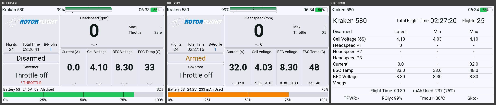

# Deck theme

*Deck* is a dashboard theme that draws its own screen from code and takes full screen for
itself, like [Urban](urban-theme.md), and it is built on Urban: the keys, the link bars, the
readings it can show, the pages it opens in full screen and the statistics screen are Urban's,
in Deck's own colours. What is Deck's own is the flight screen: a header across the top, a column
of three cards on the left, a big card over a row of value cards on the right, and a battery strip
at the foot -- each card showing what the pilot puts on it.

## Where to find it

*System* → *Settings* → *Dashboard* → *Theme*: choose *Deck* for a flight phase, or for all
three. Its settings are under *System* → *Settings* → *Dashboard* → *Settings* → *Deck*, split
into six pages: *Look*, *Cards*, *Value Cards*, *Top Bar*, *Keys* and *Telemetry*. They are stored
for the radio, and a model can carry its own under
[*Per-Model Settings*](../pages/settings/dashboard/overrides.md) where per-model settings are
switched on. Its tile carries an icon of its own, a small picture of its flight screen. Its words
come from the suite's translations, so it speaks the language of the package that was installed.

## What it shows

**On the ground and in flight** one screen, which does not change shape at spool-up:

- **Header** — in full screen the menu and the tool buttons at the left; the model name; in the
  middle the receiver's link figure beside up to four stacked link bars, as on Urban; the clock;
  the radio's battery at the right. On a receiver whose link reading is a signal strength in dBm
  rather than a link quality in percent (the suite falls back to the receiver's `1RSS` or `2RSS`
  sensor where there is no `RQly`), the figure shows the strength in dBm and the RQ bar stays
  empty instead of reading a negative number as a quality.
- **Cards** — three down the left and one big card at the top right, chosen on the *Cards* page.
  A card shows any reading of the list the value cards choose from, or one of these:
  - *Model image* (first card only): the model picture, with the flight controller's flight
    count, total flight time and battery profile under it. While the suite is waiting for a
    battery pick on this connection the battery profile's word is drawn in the warning colour.
  - *Arm state*: armed or disarmed in the colours chosen on the *Look* page, *No FC connected*
    while no flight controller answers. It says *MAIN POWER LOST* in red while the main pack is
    lost and the flight controller still answers, and the speed controller's live verdict in its
    level's colour while the controller reports a warning or a fault.
  - *Governor*: the governor state, green while active, yellow spooling up, recovering or in
    bailout, red with the card's outline in fallback or autorotation; in the *Off* and *Limit*
    modes the mode. Under it, while the model is disarmed, the reasons that block arming in the
    flight controller's short names.
  - *Battery*: the cell count, the fuel percentage large -- yellow and red at the steps set on the
    *Look* page -- and the capacity used.
  - *Flight time*, and the flight controller's *Total time*.

  A card set to nothing leaves the column, and the other cards share its height. The heights
  belong to the positions: the first card takes about half the column, the middle one a single
  line, the third a third. A card too flat for everything drops its line under the figure first
  and then its caption. The big card has a side column with the most its reading reached this
  flight and the throttle (*Safe* while disarmed).
- **Value cards** — up to four columns under the big card, chosen on the *Value Cards* page: the
  reading's name with its unit in brackets, the figure, and under it the least and the most the
  flight reached (the flight in progress where it has a value, the last flight before that) --
  or, where the columns are too narrow for both, the most alone, and nothing where even that does
  not fit. The cell voltage of the last flight is divided by the cell count of the pack it was
  flown on. A raw telemetry sensor shows the radio's own least and most of it. Every figure shares
  one size; a reading in words (ESC status, air rate) takes the largest size up to that one in
  which it fits. A column set to nothing gives its width to the others.
- **Battery strip** — across the foot: the cell count, the pack voltage and the capacity used,
  the fuel percentage at the right, a fill bar with marks at 25, 50 and 75 % and a scale under
  it. Until the model has reported a fuel reading the percentage reads `--%`. The fill is red at
  the red step and below, yellow at the yellow step and below, and green above that -- or orange
  instead of green when the pack was not full when it was plugged in, by the same verdict Urban's
  gauge uses. With the main pack lost the percentage reads `--%` in red and the bar empties.

The cell voltage reads `-` until the cell count is known, and turns red below the minimum pack
voltage the widget works out for the model, as Urban's cell voltage row does.

**After a flight** Urban's statistics screen in Deck's colours, under Deck's header without the
link cluster: the model with its totals, a table of the last flight with the latest reading, the
minimum and the maximum of each row, the flight time and the capacity used beneath it, and a bar
with the transmitter power, the lowest link quality, the highest MCU temperature and the skipped
frames. The [Urban page](urban-theme.md#what-it-shows) lists the rows and says how the cell
voltage row counts the cells of the pack that flew and how long the transmitter power and the
skipped frames follow the link; both hold for Deck's screen too.

## Full screen

With *Deck* selected, full screen shows the theme itself rather than the quick menu. The theme
draws no close button: a **long press on RTN** leaves full screen. What opens where:

- **The menu button** opens the [quick menu](quick-menu.md); so do TELE and the page keys by
  default.
- **The tool button** opens the suite's tool, only while the model is disarmed; so does SYS, as it
  comes.
- **The link figure and bars** open the *ELRS* link page.
- **A card showing a reading, flight time or total time, and the row of value cards** open
  *Telemetry*: up to twelve readings as tiles, chosen on the *Telemetry* page, each with the least
  and the most the flight reached.
- **The arm state and the governor cards** open *Status*: the arm state with what stands in its
  way, the governor, the throttle, the speed controller's live verdict and the event log.
- **The battery card and the battery strip** open the *Battery* page.
- **The model image card** opens *Profile & Tuning*: the in-flight tuning surface and, while the
  model is disarmed, the battery profiles, each with its cell count and warning voltage under
  its capacity where the flight controller reports them.

These pages, the quick menu, the battery picker and the battery profile page are the ones
Urban draws, in Deck's colours;
the [Urban page](urban-theme.md#full-screen) describes each of them, the *Link view switch* that
opens the *ELRS* page on a switch, and what the keys do. Every place that takes a press has the
radio's frame around it while *Frames on tap areas* is on.

## Settings

| Page | Setting | What it does |
| --- | --- | --- |
| Look | Colour scheme | *Light* (default) or *Dark*. |
| Look | Arm state colours | *Amber and grey* (default): armed amber, disarmed in the label colour. *Green and red*: armed green, disarmed red. |
| Look | Frames on tap areas | *On* (default) shows the radio's own frame around every place on the full screen that takes a press; *Off* covers it. |
| Look | Battery yellow at | The fuel percentage at and below which the battery strip and the battery card turn yellow, 0 % to 100 %, default 20 %. |
| Look | Battery red at | The fuel percentage at and below which they turn red, 0 % to 100 %, default 0 %. It cannot be set above *Battery yellow at*. |
| Cards | Left card 1, Left card 2, Left card 3 | What the three cards of the left column show, top to bottom: *Model image* (first card only), *Arm state*, *Governor*, *Battery*, *Flight time*, *Total time*, a reading, or nothing. Defaults: model image, arm state, governor. |
| Cards | Big card | What the big card shows, from the same list without the model image. Default: headspeed. |
| Value Cards | Value card 1 … Value card 4 | The reading each column shows: everything Urban's value rows offer (see the [Urban page](urban-theme.md#settings)), or nothing. Defaults: current, cell voltage, BEC voltage, ESC temperature. ESC load is offered and not a default: it reads `-` on a model whose controller limit is not known. |
| Value Cards | Units beside the values | The unit in brackets after each card's caption. On by default; where a caption does not fit with its unit, the unit is left out. |
| Value Cards | Temperature colours | Colours the ESC and MCU temperature readings, as on Urban. *Off* (default), *Standard* or *Early*. |
| Top Bar | Clock, RQ bar, TQ bar, RSSI bars, Transmitter battery, Colour the bars, Link view switch | As on Urban, with Urban's defaults. *RQ bar* also switches the link figure beside the bars. The link bars' warning and critical steps are not set here: they are the levels of the link announcements, as on Urban -- see [the link steps](urban-theme.md#the-link-steps). |
| Keys | Key PAGE >, Key PAGE <, Key MDL, Key SYS, Key TELE | As on Urban: for the keys left on *Theme* at *System* → *Settings* → *Dashboard* → [*Keys*](../pages/settings/dashboard/keys.md), unbound until the pilot binds them, a key held radio-wide marked *(global)* -- as the radio comes PAGE >, PAGE <, SYS and TELE, so a PAGE binding here takes effect only once PAGE is set to *Theme* there; *Theme: Tuning* opens *Profile & Tuning*, *Theme: Status* the *Status* page, and so on. |
| Telemetry | Tile 1 … Tile 12 | The reading each tile of the *Telemetry* page shows, from the same list as the cards. Defaults as on Urban. |

Every setting Urban has is carried but one: *Status bar: TPWR*. Deck has no status bar on its
flight screen, so there is nothing for it to switch; the transmitter power is on the *ELRS* page,
can be put on a card as *TX Power*, and stands in the statistics screen's bar after a flight.

The link bars, in the header and on the *ELRS* page, take their amber and red steps from the
announcements under *System* → *Settings* → *Audio* → *Events* → *Link*, exactly as Urban's do:
the [Urban page](urban-theme.md#the-link-steps) lists which announcement each bar follows. A value
an earlier version of Deck stored for *Link good above*, *Signal good above* or *TX power limit*
stays in the settings file and is no longer read.

## What it reads

What Urban's flight screen declares whatever its rows show -- the transmitter's link quality and
power, the air rate's sensitivity floor, whether a second antenna has been seen, the
skipped-frame count and the speed controller's live status -- plus whatever a card that is drawn
needs; a raw telemetry sensor on a card also declares the radio's least and most of it, for the
range under the figure. The *Telemetry* and *ELRS* pages name their own readings, as on Urban. The
statistics screen declares only the transmitter power and the skipped-frame count of its bar
(`TPWR`, `*Skp`) and reads everything else from the flight record. A reading the model does not
carry shows `-`.

## What it does not do yet

- **The flight screen has no status bar**: the transmitter power and the skipped-frame count are
  not on it unless a card shows *TX Power*; the arming reasons show on the governor card while
  the model is disarmed, and *MAIN POWER LOST* and the speed controller's live warning on the arm
  state card. With neither card on the screen they are on the *Status* page, which is then reached
  by a key only.
- **The PID and rate profiles are not on the flight screen**: the model image card carries the
  battery profile; the in-flight tuning surface shows the others.
- **A copy in the user folder draws with the shipped files**, as Urban's does.
- What Urban's page lists for its *Telemetry* and *ELRS* pages and its statistics bar holds for
  Deck's too.

## Related

- [Urban theme](urban-theme.md) — the pages Deck shares with it, described in full.
- [Dashboard themes](../developer/dashboard-themes.md) — the manifest keys, `fullscreen`,
  `sources` and the settings pages this theme uses.
- [Quick menu](quick-menu.md) — what opens over the theme in full screen.

*Documented against RFSuite 0.1.7.*
