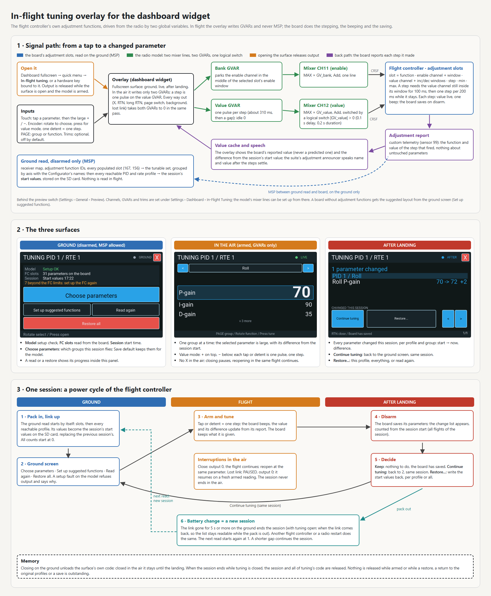
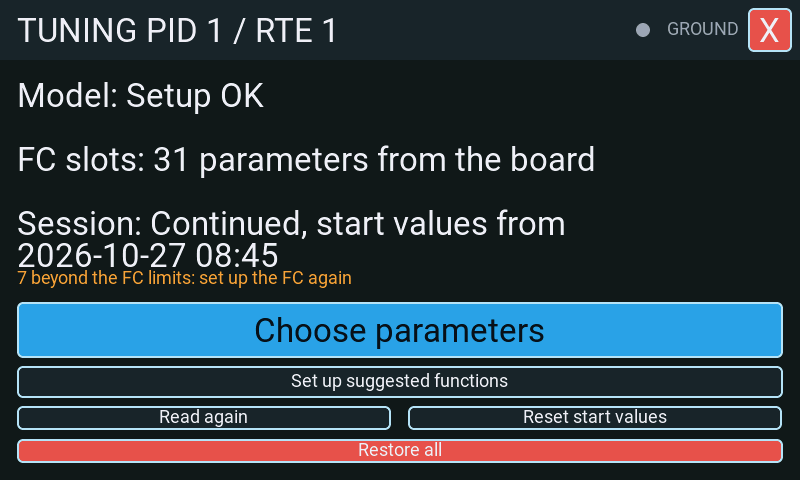
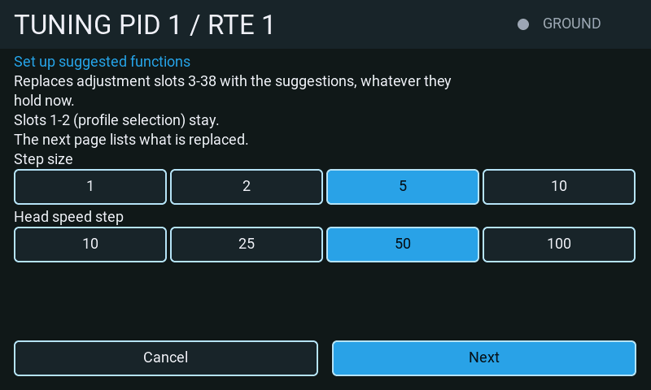
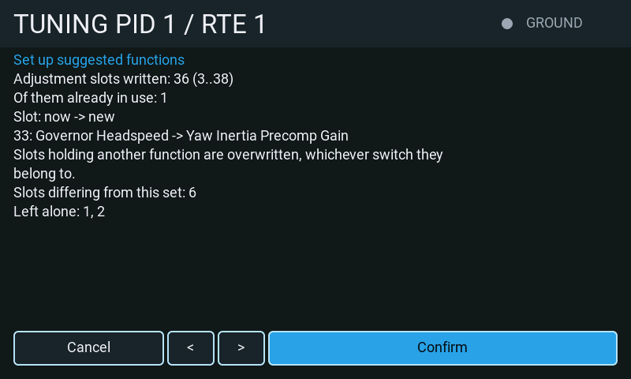
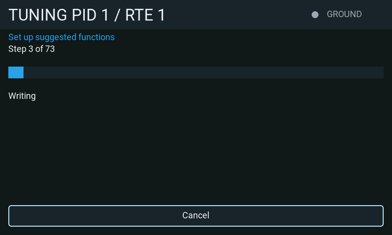
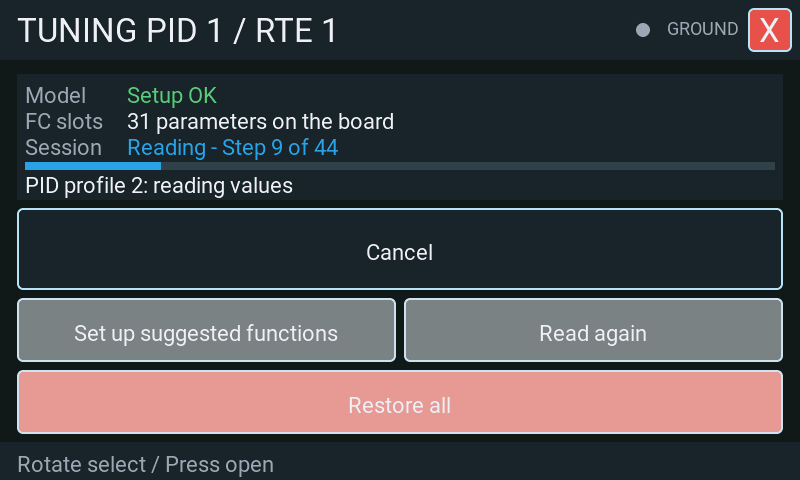

# In-flight tuning overlay

A surface the dashboard widget puts in front of the theme while a switch is on, so that the
flight controller's own adjustment functions can be driven from the air without a menu.

It is a **preview feature**: it is hidden until *System* → *Settings* → *General* →
*Preview* → *In-flight tuning* is switched on, and switching it on asks first. It changes the
flight controller's parameters in flight.

## What it drives, and what it does not

The overlay never speaks MSP in the air. Everything it does while the model is armed is a
write to two EdgeTX global variables, which two mixer lines put on two channels; the flight
controller's own adjustment functions do the stepping, the beeping and the saving. That is
what makes it work while armed at all — the suite's MSP queue is cleared on every armed tick,
so anything that needed a reply would simply be dropped.

MSP is used on the ground only, and refused while the board is armed, while the rotor is
turning, and while the arm state has not been read at all.

## Setting it up

The radio wiring stays in
[*System* → *Settings* → *Dashboard* → *In-Flight Tuning*](../pages/settings/dashboard/inflight.md):
the master switch, interlock switch, channels, variables and optional trims.
**Set up the model** shows its proposed mixer, pulse-timer, variable and trim changes before writing.
A model set up by an earlier version needs this once more if its value line has no logical
switch and the check reports **Mixer line missing or wrong**.

A model whose board carries tuning slots is now tunable whenever the radio's master switch is on.
The per-model tuning switch has been removed; old stored switch and set-layout values are ignored.
The model setup check must still pass before the interlock can drive the channels.

With **Drive rows from the trims** on, the check also needs to know which of the radio's
switch positions are its trims. The first time the interlock is closed after the widget
starts, or after these settings change, the surface the closing brings up shows **Model: Checking
trims** while the radio's switch list is read, a slice per pass, and the interlock stays refused
until that is done — about one pass of the widget for every 32 positions the radio lists, plus one.
Until the check after that first closing is in, the ground surface reached from the quick settings
menu reads *Setup not checked*, and a fault of the model is shown only once the interlock is
closed. A trim the overlay
claims has to be off in every flight mode, not only the active one. A flight mode that uses
another mode's trim (EdgeTX's default for FM1 to FM8, which follow FM0) counts as that mode;
one with a trim of its own, or with an offset of its own on top of another mode's, counts as
trimming. The fault reads **Trim still active**.

The set is always derived from the board's adjustment slots during the ground read; no
parameters are offered before that read. The slots determine both the parameter names and
the channel values used to step them. Plus and minus use their increment and decrement
windows independently, including when they are not mirrored about channel centre. Touch
buttons and trims use the same values for the selected bank and row. A step window that is
missing, unreachable, outside the range the flight controller reads, or shared with another
slot of the same bank is refused, so one press never steps two parameters.

A bank is offered only when the value that parks the enable channel in it -- the middle of its
enable window, held inside the channel's reach of 988 to 2012 µs -- lies inside that window and
inside no enable window of another slot on the same two channels. A window that lies beyond
988 to 2012 µs, or one whose middle also lies in another slot's window, could otherwise step
another slot's parameter while the screen names this bank's, and a continuous slot sharing
the bank's own window could move as well. Such a bank contributes no entries to the flying
list and no press, trim or hold steps anything in it; its slots are counted as **skipped** on
the **FC slots** status line. An empty or wholly unusable read shows **No usable slots on the
board** and clears the old row names. Before the read the line says **Not read yet**.

**Set up suggested functions** on the ground screen writes the suggested 36-cell layout, with each parameter's
full range as its slot minimum and maximum. The overlay still derives its set from the next
ground read. A cell whose current value lies outside its slot's minimum and maximum refuses
its step until the flight controller is set up again; the **FC slots** warning counts these
cells. This prevents the FC's clamp from jumping an out-of-range value to a slot boundary.

## The three surfaces

Open the tuning screen with the interlock switch or the dashboard quick menu. What it shows
follows the flight.

### On the ground, before the flight

Three status lines show **Model** (the setup verdict), **FC slots** (the number of parameters
read from the board, plus skipped slots), and **Session** (continued or new, with the stored
start-values date and time, or a not-read/refused status). Each reserves two text lines on
480x320 and 800x480 displays; 480x272 uses one cut line each. A separate warning counts values
beyond the FC limits and asks for FC setup again.

**Choose parameters** is the large, full-width primary action. It opens the session parameter
picker and is visible and active only after the board supplies at least one usable parameter.
The picker lists everything the board carries, six rows a page; the arrows turn the pages through
the groups, and a tap chooses or drops a parameter, at least one staying chosen. It starts from
what is offered now: the session's choice, else the model's flight list, else everything.
**Apply** keeps the choice for this session only; it lasts until **Reset start values** and is
never written to the model by itself. **Save default** also stores it as this
model's flight list on the next pass; the ground surface says if that write failed. **Cancel**
changes nothing. The picker closes when the model is armed.
The flight list is edited only here, on the ground screen; the radio settings have no second editor.

**Set up suggested functions** is a small secondary action when the board offers parameters.
After a completed read with no tunable slots on the configured channel pair, a line explains
that the FC has no adjustment functions for in-flight tuning and this becomes the large primary
action in place of **Choose parameters**. It is absent while armed or during a read or restore.

The setup surface says what it writes before anything is read: adjustment slots 3 to 38 are
replaced with the suggestions whatever they hold now, and slots 1 and 2 (the profile selection)
stay. It then offers **Step size** (1, 2, 5 or 10) and
**Head speed step** (10, 25, 50 or 100), prefilled from this model's saved choices; the defaults
are 5 and 50. Touch and the hardware encoder select them. **Next** reads the receiver map and
slot function IDs and shows how many slots will be written and how many hold another function. It names
up to six slots holding other functions and counts the rest: those functions are overwritten,
regardless of which switches use them. Slots are numbered from 1, as on the Adjustments page;
slots 1 and 2 are kept. Channels and windows are checked
by the read-back, since the plan reads function IDs only. Pages break between complete sentences
and slot entries; **Confirm** follows the last plan entry.

Only the function of each slot was read. Which channel it watches is checked after the write.
The values only come back to the radio with telemetry sensor 99 selected and CRSF custom telemetry on.

**Confirm** writes each suggested slot, saves once on the FC, then reads back and compares every
written record. One progress screen shows **Step x of y**, a bar and the current operation.

Only a matching read-back saves the selected step sizes to this model, on a separate idle pass.
It then drops the old board set and starts a fresh ground read continuing the session.
An error is shown in words with **Back**. **Cancel** is available until the write is verified;
the success result then closes itself into the fresh read. Cancelling after
some writes requires another ground read; it does not undo slots already written. Arming, link
loss or a different board cancel the job without another request. Setup is ground-only and
never sends MSP while armed.

Below it, **Read again** refreshes the same session profiles without changing the stored start
values. **Reset start values** first asks for confirmation: it replaces the stored start values
with the current ones, and **Restore all** will then return to those new values. Confirmation
starts a ground read of the reachable profiles; the baseline is replaced only after the whole
read and return to the original pair succeed. Cancel leaves the stored start values untouched.
**Restore all** is set apart at the bottom in the destructive-action colour and opens the
existing confirmation naming its targets. No spare FC profile is reserved; old stored
spare-slot settings are ignored.

A read or restore shows a progress surface with a **Reading** or **Restoring** title, a bar,
**Step x of y**, and the current operation. The widget zone shows the same surface without the
buttons. Before the first profile is read, a saved session is checked on the SD card
(*Checking the saved session*); then the active profiles are read. **Cancel** is offered only
during a read, before the return to the original profiles; a restore must finish its writes and
return.

The reachable set is the union of `adjMin..adjMax` from all PID-profile (function 2)
and rate-profile (function 1) adjustment slots, capped to 1..6 and the FC-reported counts,
plus the active profiles. With no selector slot, only the active profile of that kind is read.
The FC implements these switch slots as continuous adjustments; two slots can add disjoint ranges.

The ground job selects every reachable PID profile with MSP 210, then reads PID tuning,
PID profile, governor profile and rescue profile. Rate profiles use the same select command
with bit 7 (`0x80`) and read RC tuning. Governor configuration and accelerometer trim are
read once globally. Profile indices on the wire are zero-based. STATUS checks bracket each
profile's records. Work is sliced per widget pass and a partial read never replaces the cache.

The job always returns to the pair active at its start, including after errors/timeouts.
Arming aborts the read immediately; no MSP is queued while armed. A disconnected/armed return
is retained until the same FC is connected and disarmed. The surface says **Original profiles:
return pending**. If the return itself fails, **Read again** requests another return; no start-value reset
or restore can replace the pending transaction. A switch held in the same position does
not undo an MSP selection: firmware applies that switch only when its computed position changes.

Snapshots live beside the suite's MCU-keyed model preferences, under
`rfsuite.user/<model-id>.inflight.lua`. They contain a version, UID/FC signature, craft name,
clock timestamp, a profile manifest and tunable values per scope. A complete temporary Lua-data
file is verified in slices before promotion with the suite's FAT delete/rename convention.
Only session starts write the baseline; adjustment reports do not write the card. Reconnects
reuse a matching saved baseline and reread its profiles, preserving the previous start values.
Missing/incomplete/foreign baselines refuse restoration. The baseline is an undo for tracked
parameters, not a full FC configuration backup.

### In the air

The overlay uses a Rotorflight dark palette with a blue accent. The historical
[flight screenshot](../images/inflight/overlay-live.png) shows the former bank surface;
the image is retained as a reference and does not depict this interface.

The current group is the title, for example **Pitch**. Tapping it opens the radio's menu of
every group, and choosing one jumps straight to its first function; on a radio without that
menu the tap steps to the next group. The arrows beside the title select the previous/next
function of the group, in browse and in value mode, and stop at its ends with the end tone.
There is no permanent bank strip. The
fixed order is **Cyclic, Roll, Pitch, Yaw, Governor, Rates, Filter, Cross Coupling, Rescue & Level,
Acc Trim, Other**; groups with no safe cells are absent. Cyclic contains Cyclic Master Gain (83) only when the FC has a safe slot for it. Within an axis, **P, I, D, F, B, O**
come first, followed by the other functions in the function table's order. Profile selectors
are excluded. Unknown function ids appear under Other with their number.

The list comes from the board's ground-read adjustment slots. Each full function name retains its
original bank and row on the channel pair; grouping changes no FC adjustment slot. A cell
with only one safe direction remains listed, and its other direction refuses. A cell with
neither safe direction is absent. The current row occupies a one-row scroll sensor; the
neighbouring rows use non-focusable labels with current values and signed session differences.
The selected row has a blue outline and fill, is taller than its neighbours and shows its value
in a larger font; it stays at the second list position and the neighbours scroll around it.
Counts above and below identify hidden functions. Larger surfaces show more rows and larger
selected figures. Touching the sensor row selects its value.

**Touch is primary.** Tap a parameter to enter value mode. The value is large; the large
minus and plus targets send steps. Tapping the parameter name leaves value mode. A tap
starts one pulse. A held touch target retains the existing pulse/gap repetition and the
five-second maximum hold; a lost release is bounded by that maximum. Values are the last
FC reports, never predicted changes. Under the value, **Start N / +/-difference** compares
against the SD session baseline of the active PID/rate/global scope. An unknown start value
leaves that line empty. The value is drawn in the largest font the radio has, on the left.
Plus and minus are stacked in one column on the right, as large as the surface allows: plus on
top in the accent blue, minus below in orange, so the two can be told apart without reading the
glyph. The full-width name remains the
one-row encoder sensor. The footer gives PAGE, encoder and RTN hints. Reports update snapshot
text without rebuilding the scene.

After a touch action in browse or value mode, the live scene is rebuilt to return encoder
focus to the tuning sensor. A held plus/minus target waits until release before rebuilding.
This also applies when a touch step is refused during a pulse or cooldown; the next encoder
detent uses the tuning sensor again and remains subject to the same pulse/cooldown rules.

**PAGE up/down** selects the previous/next group in browse. In value mode it selects the previous/next function within the current group, keeps value mode, and announces the new name and current value. Group ends give an end tone without wrapping. PAGE during a step, pulse or cooldown is refused and spent, never queued. Function navigation and value reports retain the scene.
**RTN** leaves value mode. While the model is armed it does nothing more, and no tuning surface
carries a Close, including busy reads, setup and restore dialogs before the live phase.
On the ground and after landing RTN from browse, and the Close in the header,
return to the dashboard's fullscreen quick menu. Fullscreen stays open, and the session's start
values, steps and post-flight comparison remain available when tuning is reopened from that menu.
Every flight starts at the first function of the first group. The overlay
owns these release events ahead of pending builds and theme bindings. Navigation stops at list ends and gives end feedback; a request during a pulse or
cooldown is refused and never queued. Closing clears the variables, cancels pending speech and
leaves value mode. The interlock must be released before it can activate tuning again; the quick
menu can reopen the read-out immediately.

**Encoder:** rotate to highlight the previous/next function and request its settled name
announcement. Press once to select it. In value mode, rotate one row to request one signed
step and press once to return to browse. No native number editing or number keyboard is used.
The sensor viewport is exactly one button high: LVGL scrolling a newly focused button into
view supplies `scrolled(x, y)`. Duplicate positions do nothing. A jump of more than one row
never becomes steps: browse gives end feedback and keeps the selection; value mode only
re-baselines. Busy detents are spent and never replayed. The 64-row value ladder starts in
the middle. Selection/value text stays reactive; function navigation and value reports rebuild
no sensor.

**The ladder is endless.** The encoder walks the scene's focusable objects in creation order and
wraps, and moving buttons on screen does not change that order: past the last row of a ladder
half the walk would continue into the minus/plus targets and the group controls, where a press
changes the selection. So when the focus comes within four rows of a half's end, or reaches a
guard row, the live scene is rebuilt: the selection, value mode and the step state are kept, the
new ladder starts in the middle again, and the first detent after the build lands on a half's
entry row. In one direction that is one build of the live surface about every 28 steps. In
browse the same happens at the list ends, after the end feedback. A detent that arrives while
the build is pending is absorbed by the rows left before the end.

Lua buttons expose no focus-disable property, so the touch controls stay in the focus group;
the rebuild keeps the encoder from reaching them. The fullscreen widget itself also remains a
native focus target between the last and first sensor buttons. Rotation onto that target emits
no sensor callback, so a reversal across it can consume a detent without a step. ENTER there
still selects or leaves value mode. Touching a sensor row or using PAGE in browse recovers the
selection, and RTN keeps its level-back role.

The focus/scroll mechanism is supported by the firmware sources; physical delivery, native
layout and recenter event ordering still need a simulator/radio bench run. Debug tag
`rfsuite.inflight.input` records every scroll (y, row, delta, decision) and sensor press.
Lua cannot distinguish an exact-row touch scroll from a focus scroll; fractional drags are
ignored. No raw rotary event handler is used.

**Trims are optional and off by default for everyone.** Existing users who tuned with trims turn them on again in the settings; their saved assignments remain supported. In
Walk and adjust, the group trim changes group and the walk trim highlights functions inside
it; the adjust trim steps the highlighted function. One-trim-per-row keeps its hidden slot-row
addresses. A trim cannot step a parameter excluded from the flying list. A trim press is one
step however long it is held; touch, encoder and trims share the same pulse ownership guards.

**Session profiles can switch freely on the ground and in flight.** The header prominently
shows both active PID and rate numbers. Every profile edge ends pulse/hold ownership and clears
the value output. Cached values follow their PID profile, rate profile, or global scope.
An AdjF/AdjV report is attributed to the profile active when sampled. Since these reports carry
no profile ID and remain held, an edge fences reports and steps until AdjF is explicitly idle.
**Waiting for fresh adjustment telemetry** explains that refusal. No scene is rebuilt on reports.

Rotorflight remembers the last value written by each stepped adjustment; switching profiles
does not reset that memory. If a step on the new profile would produce that remembered value
(for example, after copying profiles), the first step in the same direction does nothing.
Further steps in that direction can also be ignored until a step in the opposite direction
changes the value and clears the tie.

An unread PID/rate profile or unknown PID#/RTE# refuses steps with a clear reason and
`inflight/paused.wav`. Returning to read profiles resumes without an interlock cycle; the held
report fence still applies. Add another profile with **Reset start values** on the ground.

**Speech uses the existing Adjustments announcer and its audio setting.** A selected group
or highlighted function waits **700 ms**; every newer selection replaces the pending name.
Selecting a function for tuning plays `inflight/selected.wav` before its name and current known value. Profile edges belong to the general *PID Profile* and *Rate Profile* announcements when those events are enabled; the overlay supplies `evt/profile.wav` plus the number only when the corresponding general event is disabled. In flight, unread/unknown profiles play `inflight/paused.wav`; returning to a read profile plays `inflight/resumed.wav`. Neither session cue plays on the ground. Every function and every group is spoken as one recording of the name the screen shows, `inflight/fn/<id>.wav` and `inflight/group/<id>.wav`. The names are the Rotorflight Configurator's own adjustment-function names in each language (for example *Heck B-Gain* / *Yaw B-gain*), so the pilot hears and reads the same words as in the Configurator. Under the group title a name does not repeat it (*P-Gain* under *Drehzahlregler*, not *Drehzahlregler P-Gain*); a name that does not begin with the title, and every spoken name, stays whole. In the selected row a name too long for one line breaks onto a second line; the neighbouring rows cut it.
Critical alarms suppress advisory adjustment/navigation speech. Already handed-over firmware
audio is not cancelled. Encoder browse scrolls use this same settled-name path.
The end-of-list tone is input feedback and plays with adjustment announcements disabled;
the existing critical-alarm guard still applies.

A per-model **flight_list** scalar can restrict the list to comma-separated adjustment function
ids; an empty string means all safe parameters. A stored id no longer driveable on the FC
is named by the setup check and refuses the interlock. Choose it under **Settings > Dashboard > In-Flight Tuning > Flight list (this model)**. The picker uses the completed ground slot read for this FC and channel pair; without slot data it shows the function table's tunable entries and says so. Choose a group, then toggle parameters; Previous/Next pages through groups longer than six rows. Stored unavailable IDs remain checked and marked **(missing)** until removed. **All parameters** clears the stored list; at least one parameter must remain selected in a filtered list. Save with the same FC connected to store this model's list. The picker sends no MSP; read the slots on the ground before checking availability. Opening it closes the radio sections to bound construction work. Native acceptance of the controls remains pending.

In the widget zone the surface is a read-out; a long press opens the touch controls fullscreen.

### After landing

The complete change list is grouped by **PID profile**, **rate profile**, then **Global**;
each profile contains the same function groups as the flying list. Rows show SD start value,
last reported value and signed difference. The count is since the SD session baseline, which
can span flights. Each page repeats its profile/group heading and stays within one profile.
Blue Previous/Next controls (or PAGE/the walk trim) page the list. **Restore / read values**
opens the action menu with **Restore all**, **Read again**, the displayed profile/global restore,
and **Back to changes**. Opening or leaving this menu sends no MSP. Rate-profile pages state
that a PID-profile restore does not cover their values; their own restore and Restore all do.
**Read again** selects and rereads all session profiles while disarmed, returning to the original
pair, to replace reported values with exact FC records. It preserves the SD baseline.

**Restore profile PID N**, **Restore profile RTE N**, and **Restore global** refer to the profile
on the displayed page. **Restore all** covers every baseline profile and the global values.
A confirmation names the target profiles before any restoration starts. Restoration is refused
while armed, without a known disarmed/rotor-stopped state, while another transaction is pending,
or with a foreign/incomplete baseline.

For each target, the job selects it, reads the affected current MSP records, changes only tracked
fields with the matching set commands, and compares the RAM read-back. Untracked fields retain
their just-read values. There is no EEPROM write between targets. After all targets, the job
selects the original pair, writes EEPROM once, and confirms the active pair by STATUS. Continuous
profile switches can reassert their channel-selected pair at this save; the original pair is
accepted. The job then selects and rereads each restored target without another write, comparing
the complete records again, and returns to the original pair.

Per-target results distinguish RAM verification with an unconfirmed save, an acknowledged save
with read-back pending, and verified read-back after the save. The last case proves a save
acknowledgement plus immediate rereading, not survival of a power cycle. A failed restore may
already have written some fields: this is not an atomic FC rollback. An uncertain save is not
repeated automatically. Return recovery remains deferred while armed or disconnected.

Read and restore jobs show their current target instead of the change list; restore/read actions
are unavailable until the job finishes. Temporary profile selections and the final return are
silent in both the overlay and the general profile announcer, including with the interlock off.
Ordinary in-flight profile announcements remain enabled.

Closing on the ground and releasing the interlock retain the in-memory session and the completed
SD baseline. Only an explicit session reset or the existing model, flight-controller and link
changes end the session. Closing, backgrounding, link loss and profile edges clear
pulse/hold ownership and GVAR output in the flight mode where it was written. MSP never runs
while armed. Existing setup, collision, range, trim, pulse and input ownership refusals remain.
The encoder has two scroll windows sharing one input owner and the same row set. Their creation
order brackets the touch controls, so first focus entry in either direction scrolls a window.
ENTER before native child focus selects the current function. End guards give feedback and keep
ENTER usable. Duplicate unchanged scroll callbacks do not add input or trace noise. Navigation
and telemetry reports retain both windows. Native encoder ordering, rendered layout, SD power-loss
behaviour and FC acceptance still need an isolated simulator/radio/FC retest. Historical screenshots
show the former UI.

An always-active adjustment slot on the tuning value channel can fire in every bank. A step direction whose pulse would also trigger that slot is unavailable; other safe directions remain available. The slot is included in the skipped count.

Ground reads accept the firmware range of PID gains and rescue altitude P/I/D gains (0 to 1000) and of the governor head speed (0 to 50000), even when a value exceeds the Configurator's standard-slot range. Values outside the firmware range refuse the read with the function name and value. The standard-layout writer retains its Configurator limits.

After a link interruption, tuning waits for the flight controller's UID to answer. The paused surface says *Waiting for FC identity*; a matching identity permits tuning again. Another identified controller ends the previous session. If a read or restore was suspended, its original-profile return is still owed to the disconnected controller and is logged; it does not block a new read on the connected controller.

Opening the interlock or backgrounding the widget in flight retains the flight's steps for the post-flight list, including when the widget returns after landing. The ground model-status sentence updates as setup faults are repaired. Session timestamps are displayed as `YYYY-MM-DD HH:MM`; existing SD snapshots remain compatible.

## Related

- [Rotorflight documentation](https://doc.rotorflight.org/) — the adjustment functions
  themselves: what each one changes, its range, and how the slots are addressed.
