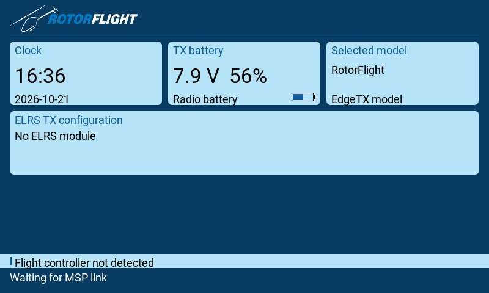
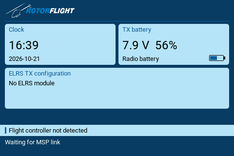

# Standby screen

When enabled, the dashboard uses one configurable standby surface while it waits for the flight controller. The header keeps the Rotorflight logo and, in fullscreen mode, the standard Suite tool entry where the zone height allows it; there is no separate Standby title. Radio information appears in rows below the header, while the current connection reason remains available at the bottom.

The editor builds the layout row by row. Every filled field in a row gets an equal share of its width, and no empty gap is stored. *+ Row* is offered only while another row fits the radio screen. *+ Field* is offered only when the existing modules and every choice offered for the new field fit at the narrower width. Each *Field* list is filtered to the modules that fit there. There are no manual size or move controls. A value too wide for its field at the normal size is drawn in the small font, and a model name or firmware string longer than its field is shortened with "...".

Until a layout is saved, a zone narrower than 700 pixels shows Clock and TX battery in the first row and a full-width ELRS row below it; a zone at least 700 pixels wide, such as the full screen of an 800x480 radio, shows Clock, TX battery and the selected model in the first row above the same ELRS row, and leaves the third row free. The ELRS row stays in the default on a radio without an ELRS module and then reads *No ELRS module*; replace it with another module to use the space.

A smaller widget zone draws the saved rows that fit it, packed from the top: a row whose fields do not fit the zone's width is skipped and the rows after it still show, and rows beyond the zone's height are left out. Rows not drawn remain in the layout and return in a larger zone. The screen does not page, rotate, or scroll.

The transmitter-battery field keeps its voltage and percentage beside a filled battery symbol; the fill follows the same radio battery range and warning level as the text. TX GPS is optional and is read only when selected. It shows fix state and satellite count. A full-width TX GPS field on an 800x480 screen also shows latitude, longitude, altitude, speed, course, and HDOP. They need three detail columns and the row height of the large screen, so every other TX GPS field shows the compact presentation.

The full-width ELRS field uses the same content on every supported radio: `Rate … | TLM …`, `Max … | Dyn …`, and the completed snapshot age. These are the module's configured Packet Rate, Telemetry Ratio, Max Power ceiling, and Dynamic setting; the Dynamic value remains the exact configured label (*Off*, *Dyn*, or *AUX9* through *AUX12* where available), rather than a boolean. The module name is not shown. Re-entering standby starts a bounded read-only refresh; EdgeTX routes CRSF to the internal module when both module bays use CRSF.

A fixed information strip summarizes the highest-priority prerequisite from the connection state already held by the dashboard. The exact connection reason and progress remain visible below it. The strip adds no radio or telemetry polling. The standby surface does not replace flight state: active-flight link loss, postflight view, and offline summary keep the existing dashboard behavior. Turning the option off restores the normal connection splash.

Configure it under *System* → *Settings* → *Dashboard* → *Standby screen*.

TX GPS reports the transmitter's built-in receiver. EdgeTX exposes neither GPS-time status nor a reception timestamp, so an unavailable value makes no hardware or freshness claim. Missing readings remain unavailable rather than becoming zero.

Offline regressions verify configuration, geometry, and state routing. The final packaged screen and physical ELRS and internal-GPS timing remain to be checked.
