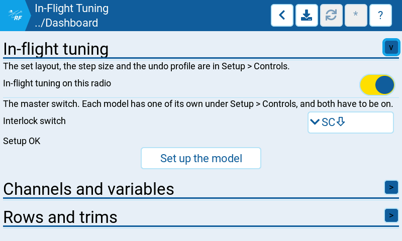
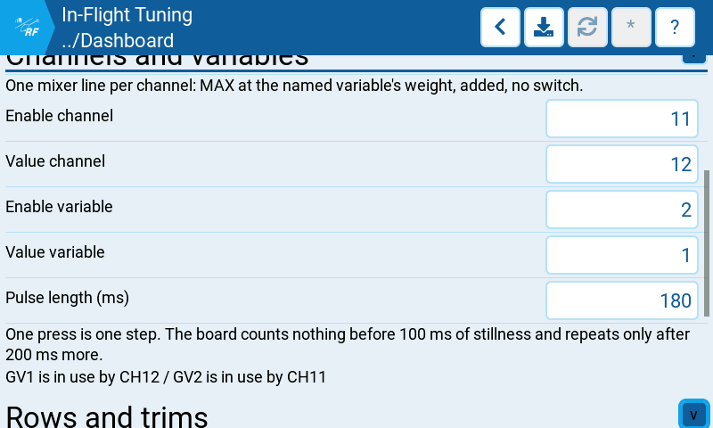
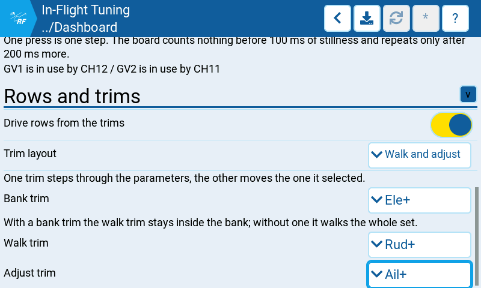

# In-Flight Tuning

The radio's half of the in-flight tuning overlay: which channels and global variables carry it,
and which trims move it. These settings belong to the
radio and apply to every model on it, so no flight controller has to be connected to change
them. Suggested FC functions and their step sizes are set up from the tuning screen on the ground.
A model whose board carries tuning slots is tunable while the radio's master switch is on and
the tuning fullscreen is open in the foreground. Enter the dashboard's fullscreen quick menu
on the ground and choose **In-flight tuning**; while the model is armed the entry is not offered. The dashboard zone continues to show its theme.

What the overlay itself does in the air is in
[the dashboard guide](../../../dashboard/inflight-tuning.md).

## Where to find it

*System* → *Settings* → *Dashboard* → *In-Flight Tuning*

Hidden until *System* → *Settings* → *General* → *Preview* → *In-flight tuning* is on.

## Settings

### In-flight tuning

| Setting | What it does |
| --- | --- |
| In-flight tuning on this radio | The master switch. With it off nothing drives on any model. Off by default. |
| *(model status)* | What the setup check found when it last walked the model: *Setup OK*, *Setup not checked*, or the faults it names — or *Reading the radio...* while the page opened from the dashboard is still reading (see Notes). A fault refuses output and is shown on the tuning fullscreen ground surface. |
| Set up the model | Writes the two mixer lines, the logical switch that times each press, the global variable details and the trim modes this model needs — and only the ones that differ from what the model already carries. It shows what it would remove and what it would add first, and writes nothing until that is confirmed. Where the model already carries all of it, it says so instead of asking. It writes the values as they stand on the page, saved or not. |

*Set up the model* is a comparator, not a rewrite. A channel that already carries nothing but
the line the overlay needs is left alone; a variable whose name, range, precision and unit are
already right is not written; a flight mode whose claimed trims are already off is not touched.
A flight mode that uses another mode's trim counts as off when that mode's trim is off, so it
keeps its link.
So the button is only ever offered work that is left, and on a model that is fully set up it
reports *The model already carries this setup; nothing to write.*

**The value line is switched by a logical switch**, `|GVx| > 0` on the value variable with a
delay of 0.1 s and a duration of 0.2 s. It is what ends each pulse: the radio's mixer lets 200 ms
of a press through, timed by the radio itself, so a slow pass of the widget cannot stretch a
press into a second step. Each press holds the value variable for a fixed 310 ms, long enough for
that window to run out in full. The button takes a slot that already holds exactly that switch, or
else the last empty logical switch nothing on the model refers to, and names it in the
confirmation (*Pulse timer L64: |GV5| > 0*). It never writes over a logical switch that holds
anything else; a model with no slot left is refused with *No logical switch is free to time the
pulses; empty one first.* **A model set up by an earlier version** carries a value line with no
switch, which the check reports as *Mixer line missing or wrong* — press *Set up the model* once
more.

Every write is read back before it is counted. The radio's Lua writers answer nothing and do
nothing when a mixer table is full or an index is out of range, so a line is counted as written
only once it has been read off the model again — the number in *Model set up (n)* is the number
of changes that are demonstrably on the model.

### Channels and variables

One mixer line per channel: `MAX` at the named variable's weight, added. The enable line has no
switch; the value line is switched by the logical switch above.

| Setting | What it does |
| --- | --- |
| Enable channel | The channel that says which bank the flight controller is listening on. 5 to 16, default 11. |
| Value channel | The channel that steps the parameter. 5 to 16, default 12. |
| Enable variable | The global variable put on the enable channel. 0 to 9, where 0 is none; default 6. |
| Value variable | The global variable put on the value channel. 0 to 9, where 0 is none; default 5. |

A variable already driven by another mixer line is named under the fields as a warning, not a
refusal: a pilot who knows what that line does may still want it.

A second warning names any *other* global variable carrying one of the two names this setup
writes, `VAL` or `BNK`. A model set up once against a different pair keeps those names on the
variables it used then, and nothing takes them off, so the radio's own pages show two of each
with only one pair driving anything. A warning and not a refusal — which of them to rename is
the pilot's business.

### Rows and trims

| Setting | What it does |
| --- | --- |
| Drive rows from the trims | Whether the physical trims move the surface at all. Off by default; touch works either way. |
| Trim layout | *Walk and adjust* (default) claims up to three trims — one changes group, one highlights a parameter inside it, one moves the value. *One trim per row* gives each of the six rows its own trim, which is the layout the generic radio setup documents and needs six trims to spare. |
| Group trim, Walk trim, Adjust trim | The three trims of *Walk and adjust*. The walk trim stays in the current group; touch or PAGE changes group when no group trim is assigned. Shown in that layout only. |
| Row 1 to Row 6 | The trim belonging to each row. Shown in the *One trim per row* layout only. |

## Notes

- A trim that drives a row has to be switched off as a trim in every flight mode, or the same
  press also moves that stick's neutral in the mode where it is still on. A flight mode that
  uses another mode's trim (EdgeTX's default for FM1 to FM8, which follow FM0) counts as that
  mode; one with a trim or an offset of its own counts on its own. *Set up the model* does
  this, and the setup check reports *Trim still active in a flight mode* when it has not been
  done.
- On an ExpressLRS link use the *Wide* switch mode or a full-resolution packet rate. In
  *Hybrid* mode the value and bank channels carry 16 and 6 positions, so several rows and two
  banks miss the windows the flight controller decodes.
- These settings are saved on the radio. A save the card refuses shows *Save failed: the
  settings file could not be written to the SD card*. The widget takes a change to them on its
  own clock, and that clock is held while the model is armed — a change made in the air arrives
  after landing.
- Opened from the dashboard's full screen, the page runs inside the dashboard widget, whose
  every call the radio stops at an instruction limit. There it reads the radio's switch list
  (to find the trims) and the model's mixer and input lines (for the variable warnings) a
  slice per frame instead of all at once. While it reads, the model-status line,
  the trim pickers and the variable warnings show *Reading the radio...*, and *Set up the model*
  answers with the same line; on a model with many logical switches and mixer lines this takes
  a second or two. *Channels and variables* and *Rows and trims*, when open, draw their header
  at once and the rows under it a frame or two later, once their notes have been laid out. A
  variable changed there is not read again (until *Set up the model* has written the model; see
  below): the page keeps what it found for every variable, and shows the warning for the new
  one when its field is closed with Enter, Return or the on-screen keypad (on EdgeTX 2.11.5,
  2.12.0 and later). Changed while the page is still reading, the warning takes the place of
  *Reading the radio...* as soon as the reading is through. A field left by touching another
  control, or an older firmware, has the warnings (the variable's use and the variable names)
  brought up to date the next time the page is laid out. After *Set up the model* the next
  change of a variable reads the model again, and a reading of the mixer and input lines still
  running when the model is written starts over. The tool started from the radio's tool menu
  reads everything when the page opens, as before.

## Grouped overlay inputs

Touch is the primary input. In browse, rotate to highlight a function (settled announcement)
and press to select it. In value mode, rotate for one step per row and press to leave.
PAGE changes group in browse and changes function within the current group in value mode,
remaining in value mode and announcing its name and current value. Ends do not wrap; busy
PAGE inputs are refused and spent. RTN leaves value mode; in the air it closes nothing and there is no Close, on the ground it
closes tuning and returns to the quick menu. X is also available only on the ground. Closing
retains the session. A firmware fullscreen exit (long RTN) or a page switch in the air pauses
tuning and clears both variables immediately; it can be opened again only after the landing,
because the quick-menu entry and a bound key open tuning only while the model is disarmed. Every new flight starts at the first function of the
first group. Stored interlock-switch values are ignored.
Link loss immediately clears both variables but keeps the visit visible with **PAUSED** and
**No FC link**. The retained visit resumes automatically when link and arm telemetry return,
keeping the same group, parameter and session and still checking the flight-controller identity;
a link gone for five seconds or more on the ground (a battery change) begins a new session instead.
Firmware exit, page switch, feature off, and ground X/RTN still close the visit during a link loss.
Optional trims are off by default for everyone. Existing trim users turn them on again in settings.
Walk and adjust follows groups and their full function names, without wrapping. Slot-row
trim assignments still address the configured hidden bank/row and obey the flight-list gate.
Choose the flight list only on the tuning screen on the ground: **Choose parameters** selects
this session's list, and **Save default** stores it as the model's default. The settings page
has no per-model list section and writes only radio preferences.
Cyclic precedes Roll and Pitch and contains Cyclic Master Gain (83) when its slot is available. See the dashboard guide for sensor focus order, bench acceptance
and multi-profile session membership. A busy detent is spent, never queued.

Selection plays `inflight/selected.wav` before name and value. Profile changes play
`evt/profile.wav` plus the number. Unread/unknown profiles play `inflight/paused.wav`; returning
to a read profile plays `inflight/resumed.wav` without closing and reopening tuning. A held report still
waits for AdjF idle. Each session stores the start values of every reachable PID/rate profile on SD;
a session is one power cycle of the flight controller. See the dashboard guide.
Rates, Rescue & Level, Acc Trim and Other use the new group clips; the other groups use `adj/`.
The Adjustments audio setting and critical-alarm suppression apply throughout.

The flying overlay shows the selected function as a filled, outlined row with neighbouring
values. Value mode compares the active profile value with its session start; an unknown
start stays blank. After landing, **Continue tuning** returns to the ground screen in the same
session, and **Restore...** opens the confirmed restore actions and Read again. Paging repeats the profile/group identity.
Ground jobs show their current target and silence temporary profile announcements. Restores
verify targets in RAM, save once after returning to the original pair, then reread each target
without another write. The dashboard guide describes the verification stages and recovery.

## Related

- [In-flight tuning overlay](../../../dashboard/inflight-tuning.md) — what the surface does in
  the air.
- [Rotorflight documentation](https://doc.rotorflight.org/) — the flight controller's
  adjustment functions, which are what this drives.

*Checked against the RFSuite 0.2.1 development tree; native encoder acceptance is pending.*
