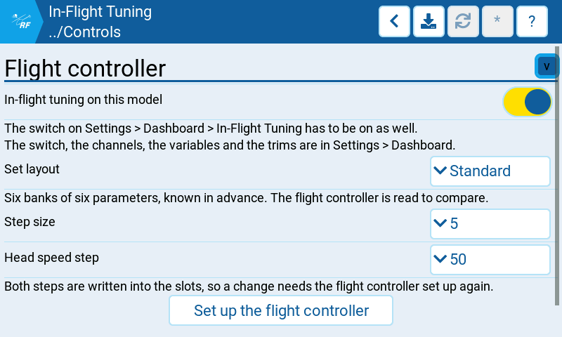

# In-Flight Tuning

The flight controller's half of the in-flight tuning overlay: which parameters this machine
offers and how far one press moves them. These settings
are stored with the model, so they travel with the helicopter. The switch, the channels, the
variables and the trims belong to the radio and are on the other page,
*System* → *Settings* → *Dashboard* → *In-Flight Tuning*.

**Both switches have to be on before anything drives.** The radio's is the master: with it
off nothing happens on any model. The one here says this machine is set up for the overlay.

## Where to find it

*Configuration* → *Setup* → *Controls* → *In-Flight Tuning*

Hidden until *System* → *Settings* → *General* → *Preview* → *In-flight tuning* is on.
Greyed out until the flight controller answers. Read-only while the model is armed.

## Settings

### Flight controller

| Setting | What it does |
| --- | --- |
| In-flight tuning on this model | The model's own switch. Off by default, and the radio's master switch has to be on as well. |
| Step size | What one press moves a parameter by, in the flight controller's own units. 1, 2, 5 or 10; default 5. |
| Head speed step | The same, for the governor head speed alone. 10, 25, 50 or 100; default 50. It has a step of its own because its range is 0 to 10000 rpm where the other parameters of the set stop at 250, or 1000 for the two rescue collectives. |
| Set up the flight controller | Reads the board in two replies, shows what each slot holds and what it would hold, writes one adjustment range per slot once that is confirmed, follows it with a single EEPROM write, and reads every written slot back field by field against the set it was asked for, both step sizes included. |

What can be tuned is read from the flight controller on the ground; **Set up the flight controller** writes the standard 36-cell layout.

Both steps are written into the slots, so changing one means setting the flight controller up
again, then reading the board again on the ground.

Setup writes each parameter's full range as its slot minimum and maximum, for example 0 to
250 for a PID gain and 0 to 1000 for a rescue collective. A cell whose current value lies
outside its slot's minimum and maximum refuses its step until the flight controller is set
up again. This avoids a jump to a slot boundary when the flight controller clamps a step.

Plus and minus use the selected slot's own increment and decrement windows, which need not
be mirrored. Nothing is offered before the ground slot read. A missing, unreachable or
ambiguous window refuses its step; a value shared with another slot of the same bank would
otherwise step both parameters. The ground surface says **Not read yet** before the read,
**No usable slots on the board** when none can be used, and counts skipped slots and values
beyond the FC limits.

The read-back after a write holds each slot against the record the write was built from, the two
step sizes among the fields it compares. Where a slot holds the right function on the right
channels and only the step disagrees — a flight controller that took the record and kept a step of
its own — the page says so instead of counting differing slots, since the step is the one field of
a slot these settings decide.

### Undo

A complete disarmed ground read backs up all reachable PID/rate profiles and global tuning
values on the SD card, per MCU-keyed model. No spare profile setting is needed; old stored
settings are ignored. The board saves in-flight changes itself after disarm, so start values
must be read before flight; this SD baseline is what the page's Undo section refers to.

On the dashboard, **Reset start values** asks for confirmation before reading the reachable
PID/rate profiles and replacing the baseline with current values; **Restore all** then returns
to those new start values. **Read again** refreshes the
same session profiles without replacing the baseline. Both return to the original active pair.
An armed abort defers that return until disarmed; the surface reports the pending return.
Read profiles switch freely without an interlock cycle. Unread/unknown profiles refuse steps;
use **Reset start values** on the ground to add a profile. The report-idle fence prevents a held
AdjF/AdjV from crossing profile ownership.

**Restore profile** and **Restore all** name their targets in a confirmation, require a matching
complete FC-identity baseline, overwrite only tracked fields in freshly read MSP records, commit,
verify, and return to the original pair. PID, rate and global values are covered. Results are
reported per target. This is a parameter baseline, not a complete FC configuration backup.

## Notes

- Saving this page writes model settings keyed by MCU id; connect the same FC to save them.
- **Set up the flight controller** writes adjustment slots after a separate confirmation.
- All MSP reads, selections and restores are ground-only, disarmed, with ARM telemetry and
  rotor checks. The profile switch is available in flight but SD restore is ground-only.
- The model flight list is under Settings > Dashboard > In-Flight Tuning.

## Related

- [In-flight tuning overlay](../../../dashboard/inflight-tuning.md) — what the surface does in
  the air.
- *Configuration* → *Setup* → *Controls* → *Adjustments* — the same adjustment slots,
  edited one at a time.
- [Rotorflight documentation](https://doc.rotorflight.org/) — the adjustment functions
  themselves, their ranges and what each one does to the helicopter.

*Checked against the RFSuite 0.2.1 development tree; native encoder acceptance is pending.*
